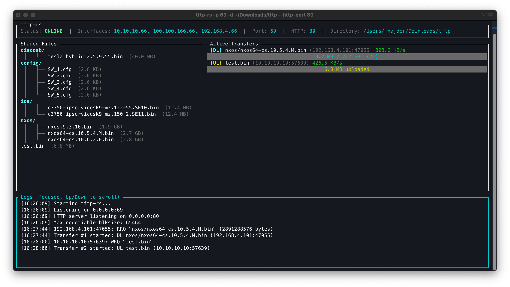

<div align="center">

# tftp-rs

**A fast, single-binary TFTP server with a live terminal dashboard, also usable as an embeddable async library**

[](https://crates.io/crates/tftp-rs)
[](https://docs.rs/tftp-rs)
[](https://github.com/mhajder/tftp-rs/releases/latest)
[](https://github.com/mhajder/tftp-rs/releases)
[](https://github.com/mhajder/tftp-rs/blob/main/LICENSE)

[](https://github.com/mhajder/tftp-rs/actions/workflows/ci.yml)
[](https://www.rust-lang.org/)
[](https://github.com/mhajder/tftp-rs#-installation)
[](https://github.com/mhajder/tftp-rs#-implemented-rfcs)
[](https://github.com/mhajder/tftp-rs/stargazers)

[Installation](https://github.com/mhajder/tftp-rs#-installation) · [Usage](https://github.com/mhajder/tftp-rs#-usage) · [Library](https://github.com/mhajder/tftp-rs#-library) · [Architecture](https://github.com/mhajder/tftp-rs#-architecture) · [Contributing](https://github.com/mhajder/tftp-rs#-contributing)

</div>

tftp-rs is an embeddable asynchronous TFTP server and a companion TUI binary. It
implements the TFTP protocol from scratch with full support for both Read
(RRQ) and Write (WRQ) operations, RFC option negotiation (blksize, timeout,
tsize, windowsize), netascii mode, and an optional HTTP file server. It is
built for the everyday network-engineering job of pushing firmware and configs
to switches, routers and PXE clients, and showing you exactly what is happening
while it does.



## ✨ Features

### Protocol

- **RFC 1350 compliant**: hand-rolled TFTP protocol, no external TFTP crates
- **RFC 2347/2348 option negotiation**: blksize up to 65,464 bytes; capped via `--max-block-size` for VPN environments
- **RFC 2349 timeout + tsize**: clients can negotiate a custom reply timeout; tsize reports file size on octet downloads and is echoed on uploads (a netascii download sends more bytes than the file holds, so tsize is left unacknowledged there)
- **RFC 7440 windowsize**: windowed transfers send multiple DATA blocks before waiting for ACK, significantly improving throughput on high-latency links
- **Netascii mode**: full bidirectional conversion (`\n` ↔ `\r\n`, `\r` ↔ `\r\0`) across block boundaries for legacy clients
- **Unlimited transfer size**: block numbers roll over correctly (u16 wrap-around), enabling files larger than 32 MB with the default 512-byte block size

### Transfers

- **Full RRQ + WRQ**: serve files to clients (download) and receive files from clients (upload); an upload is staged as `<name>.<transfer id>.part` and renamed into place once complete, and no client can read or write a staging file by name (names of the form `<name>.<number>.part`, in any letter case, are reserved for this)
- **Subdirectory support**: read and write files in nested directories (e.g. `ios/config/router.cfg`)
- **Async I/O**: built on `tokio` with non-blocking UDP sockets
- **Ephemeral transfer sockets**: each transfer gets its own OS-assigned port, keeping the main listener free
- **Request deduplication**: duplicate requests from the same peer are silently dropped while a transfer is already in progress
- **Configurable retransmission**: `--timeout` (ms) and `--max-retries` to tune behaviour for unstable networks

### Safety & limits

- **Path sanitization**: prevents directory traversal attacks
- **Overwrite protection**: WRQ for existing files can be rejected with `--allow-overwrite false` (returns error code 6)
- **Access control**: `--disable-read` or `--disable-write` to restrict what operations clients may perform (`--disable-read` refuses to run alongside `--http-port`, which would hand out the same files anyway)
- **Resource limits**: `--max-concurrent-transfers` (default 256) bounds the sockets and open files unanswered requests can tie up; `--max-upload-size` caps what a single upload may write (off by default)
- **Interface pinning**: `--interface` binds every socket to one network device on Linux and macOS, and fails instead of falling back to an unbound socket

### Dashboard & extras

- **TUI dashboard**: real-time view of server status, shared files tree, active transfers with progress bars, and timestamped scrollable logs
- **Interface discovery**: with a wildcard bind, displays the host's non-loopback addresses in the header (IPv4 for `0.0.0.0`, IPv4 and IPv6 for `::`) and refreshes them every 10 seconds; adding `--interface` narrows that to the named device's addresses, loopback included, because those are the ones the server answers on; with an explicit `--bind` it shows the one address in use
- **Scrollable panels**: Tab to cycle focus between Shared Files, Active Transfers, and Logs panels; Up/Down to scroll
- **HTTP file server**: optional HTTP server for browser-based directory browsing and file downloads (`--http-port`); uploads still in progress are neither listed nor served
- **Log file export**: optionally write all logs to a file with `--log-file`

## 📡 Implemented RFCs

| RFC                                                | Description                                     |
|----------------------------------------------------|-------------------------------------------------|
| [RFC 1350](https://www.rfc-editor.org/rfc/rfc1350) | The TFTP Protocol (Revision 2)                  |
| [RFC 2347](https://www.rfc-editor.org/rfc/rfc2347) | TFTP Option Extension                           |
| [RFC 2348](https://www.rfc-editor.org/rfc/rfc2348) | TFTP Blocksize Option                           |
| [RFC 2349](https://www.rfc-editor.org/rfc/rfc2349) | TFTP Timeout Interval and Transfer Size Options |
| [RFC 7440](https://www.rfc-editor.org/rfc/rfc7440) | TFTP Windowsize Option                          |

## 📦 Installation

### From crates.io

```bash
cargo install tftp-rs
```

### From GitHub Releases

Download a pre-built binary for your platform from the [latest release](https://github.com/mhajder/tftp-rs/releases/latest):

| Platform | Archive                                                                      |
|----------|------------------------------------------------------------------------------|
| Linux    | `x86_64` / `aarch64`, glibc (`-unknown-linux-gnu`) or static musl (`-unknown-linux-musl`) |
| macOS    | Intel (`x86_64-apple-darwin`) and Apple Silicon (`aarch64-apple-darwin`)     |
| Windows  | `x86_64` and `aarch64` (`-pc-windows-msvc`, `.zip`)                          |

Each release also has a `SHA256SUMS` file and a build provenance attestation,
so you can check that a download is intact and was built by this repository's
release workflow:

```bash
sha256sum --check --ignore-missing SHA256SUMS
gh attestation verify tftp-rs-<version>-<target>.tar.gz --repo mhajder/tftp-rs
```

### From source

```bash
git clone https://github.com/mhajder/tftp-rs.git
cd tftp-rs
cargo build --release
```

The binary will be at `target/release/tftp-rs`.

> [!NOTE]
> On Linux, port 69 is privileged. Run tftp-rs as root, grant it `CAP_NET_BIND_SERVICE`
> (`sudo setcap cap_net_bind_service=+ep "$(which tftp-rs)"`), or pick a port above 1024 with `-p`.
> macOS and Windows let any user bind it.

## 🚀 Usage

```bash
# Serve the current directory on port 69 (default), on every interface
tftp-rs

# Pin the service to one local interface address
tftp-rs --bind 192.0.2.1

# Serve a specific directory on a custom port
tftp-rs -p 69 -d /srv/tftp

# Enable log file output
tftp-rs -d /srv/tftp -l /var/log/tftp.log

# Enable HTTP file server alongside TFTP
tftp-rs -d /srv/tftp --http-port 8080

# Enable windowed transfers (RFC 7440) for faster throughput
tftp-rs -d /srv/tftp -w 4

# Set a lower timeout for fast/unstable links
tftp-rs -d /srv/tftp -t 200

# Limit blksize (useful behind VPNs with small MTU)
tftp-rs -d /srv/tftp --max-block-size 1468

# Reject uploads for existing files
tftp-rs -d /srv/tftp --allow-overwrite false

# Keep the service on one network interface (Linux/macOS). The HTTP file
# server, when enabled, is scoped to the same interface.
tftp-rs --bind 192.0.2.1 --interface eth0 -d /srv/tftp

# All options combined
tftp-rs -p 69 -d /srv/tftp -l /var/log/tftp.log --http-port 8080 -w 4 -t 200
```

### CLI Options

```text
Options:
      --bind <BIND>                    Local IP address to bind [default: 0.0.0.0]
      --interface <INTERFACE>          Bind every socket to this network interface (Linux/macOS)
  -p, --port <PORT>                    UDP port to listen on [default: 69]
  -d, --dir <DIR>                      Directory to serve / receive files [default: .]
  -l, --log-file <LOG_FILE>            Optional file path to write logs to
      --http-port <PORT>               Enable HTTP file server on the specified port
  -t, --timeout <MS>                   Reply timeout in milliseconds, at least 1 [default: 500]
      --max-block-size <BYTES>         Max negotiable blksize, 0 or at least 8 (0 = OS auto-detect) [default: 0]
  -w, --max-window-size <N>            Max RFC 7440 window size (1 = disable) [default: 1]
      --allow-overwrite <BOOL>         Allow overwriting existing files on WRQ [default: true]
      --max-retries <N>                Max retransmission attempts [default: 10]
      --max-concurrent-transfers <N>   Transfers in flight at once (0 = unlimited) [default: 256]
      --max-upload-size <BYTES>        Reject an upload past this size (0 = unlimited) [default: 0]
      --disable-read                   Reject all RRQ (download) requests
      --disable-write                  Reject all WRQ (upload) requests
  -h, --help                           Print help
  -V, --version                        Print version
```

Each TFTP transfer reuses the listener's local address and only makes its UDP
port ephemeral. With the default wildcard bind the operating system picks the
source address per reply. Passing an explicit `--bind` address guarantees
replies leave from the address the client contacted, which is what multi-homed
hosts and VPN setups need. Embedders can enforce that with
`server::validate_bind_addr`.

### 🎮 TUI Controls

| Key                      | Action                           |
|--------------------------|----------------------------------|
| `q` / `Esc`              | Open quit confirmation dialog    |
| `Tab`                    | Cycle focus between panels       |
| `Up` / `Down`            | Scroll the focused panel         |
| `Left` / `Right` / `Tab` | Toggle Yes/No in quit dialog     |
| `Enter`                  | Confirm selection in quit dialog |
| `y`                      | Confirm quit                     |
| `n` / `Esc`              | Cancel quit                      |

While the quit dialog is open it takes every key, so `Tab` toggles the
selection there rather than cycling panels.

### 🧪 Testing with a TFTP client

```bash
# Download a file from the server
tftp localhost 69
> get filename.txt

# Download a file from a subdirectory
tftp localhost 69
> get configs/switches/sw1.cfg

# Upload a file to the server
tftp localhost 69
> put localfile.txt

# Upload a file into a subdirectory (created automatically)
tftp localhost 69
> put configs/new_config.cfg
```

## 📚 Library

The package also exports a `tftp_rs` library, so you can embed the server in
your own tokio application. Add it without the dashboard and its dependencies:

```bash
cargo add tftp-rs --no-default-features
```

[`server::run`](https://docs.rs/tftp-rs/latest/tftp_rs/server/fn.run.html)
serves one local address, and
[`server::run_on_interface`](https://docs.rs/tftp-rs/latest/tftp_rs/server/fn.run_on_interface.html)
also pins every socket to one network interface on Linux and macOS. You own
the bind address, the shutdown signal and the
[`ServerEvent`](https://docs.rs/tftp-rs/latest/tftp_rs/server/enum.ServerEvent.html)
stream of logs and progress.

The quick start, examples and full API reference are on
**[docs.rs/tftp-rs](https://docs.rs/tftp-rs)**.

## 🧱 Architecture

```text
src/
  lib.rs               Embeddable library crate
  main.rs              Companion server binary, CLI args (clap), TUI event loop
  tftp_protocol.rs     TFTP packet parsing/serialization + netascii codec
                       (RFC 1350, 2347, 2348, 2349, 7440)
  server.rs            Async TFTP server (tokio), RRQ + WRQ handlers,
                       option negotiation, windowed transfer, ServerConfig
  http_server.rs       Optional HTTP file server (axum)
  ui.rs                TUI dashboard (ratatui + crossterm)
tests/
  integration.rs       End-to-end RRQ/WRQ integration tests including
                       blksize/tsize negotiation and block-number rollover
  library_api.rs       Library-facing tests: bind address and interface
                       handling, option negotiation, retransmission budgets,
                       and the error replies a client is owed
```

### Protocol Implementation

All TFTP packet types are manually parsed and serialized with Big-Endian byte order:

| Opcode | Type  | Description                             |
|--------|-------|-----------------------------------------|
| 1      | RRQ   | Read request (client download)          |
| 2      | WRQ   | Write request (client upload)           |
| 3      | DATA  | Data payload (up to 65,464-byte blocks) |
| 4      | ACK   | Acknowledgment                          |
| 5      | ERROR | Error notification                      |
| 6      | OACK  | Option acknowledgment (RFC 2347)        |

### Option Negotiation

When a client includes options in its RRQ/WRQ request, the server responds with an OACK packet acknowledging the negotiated values before data transfer begins.

| Option       | RFC  | Description |
|--------------|------|-------------|
| `blksize`    | 2348 | Block payload size, 8–65,464 bytes (default 512). Capped by `--max-block-size` and OS UDP limit. |
| `timeout`    | 2349 | Per-transfer reply timeout in seconds (1–255). Overrides the server default for that transfer. |
| `tsize`      | 2349 | On octet RRQ: server reports the file size. On netascii RRQ: left unacknowledged, since the encoded transfer is longer than the file on disk. On WRQ: server echoes back the client's value. |
| `windowsize` | 7440 | Number of DATA blocks sent before waiting for an ACK. Capped by `--max-window-size`. |

### Windowed Transfer (RFC 7440)

With `--max-window-size N` (N > 1), the server sends up to N DATA blocks before pausing for an ACK. Partial ACKs within a window slide it forward without retransmitting the already-acknowledged blocks. On timeout, the entire unacknowledged window is retransmitted. This significantly improves throughput on high-latency links.

### Netascii Mode

The server fully supports the `netascii` transfer mode:

- **Download (RRQ):** binary data is encoded on the fly (`\n` → `\r\n`, `\r` → `\r\0`) with overflow tracking across block boundaries.
- **Upload (WRQ):** incoming netascii data is decoded to binary (`\r\n` → `\n`, `\r\0` → `\r`) with carry-over state for `\r` spanning two consecutive blocks.

### Block Number Roll-over

Block numbers are 16-bit unsigned integers. The server uses `wrapping_add(1)` on every block increment, enabling files of unlimited size with any block size (e.g. a file larger than 32 MB with the default 512-byte blksize requires block numbers to wrap past 65535).

## 🧰 Tech Stack

- **Rust** 2024 edition
- **tokio**: async UDP and TCP I/O
- **socket2**: interface-bound sockets and per-transfer buffer sizing
- **libc**: interface name lookup on Linux and macOS
- **ratatui** + **crossterm**: terminal UI
- **axum** + **tokio-util**: HTTP file server and streamed file bodies
- **clap**: CLI argument parsing
- **anyhow**: error handling
- **if-addrs**: network interface discovery

## 🤝 Contributing

Issues and pull requests are welcome. See [CONTRIBUTING.md](https://github.com/mhajder/tftp-rs/blob/main/CONTRIBUTING.md) for the dev setup, checks and commit message format, and use the [issue templates](https://github.com/mhajder/tftp-rs/issues/new/choose) for bugs and feature requests.

Found a security problem? Please report it privately as described in [SECURITY.md](https://github.com/mhajder/tftp-rs/blob/main/SECURITY.md).

## 📜 License

This project is licensed under the MIT License - see the [LICENSE](https://github.com/mhajder/tftp-rs/blob/main/LICENSE) file for details.
